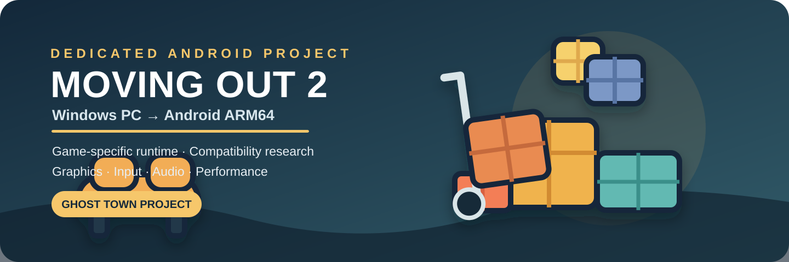

# Moving Out 2 — Android Compatibility Project

**Ghost Town Project · Dedicated Android ARM64 runtime research**

> **Experimental project.** APK build status does not mean the Windows game is booting or playable. Game first-frame, menu and gameplay compatibility have not yet been verified.

## Project goal

This repository is dedicated exclusively to exploring and building an Android application/runtime capable of launching **Moving Out 2 (PC)** on Android ARM64 devices.

This is not a general-purpose PC game launcher. Overcooked! 2, the original Moving Out, and multi-game support are out of active scope.

## Target baseline

| Item | Evidence baseline |
|---|---|
| Game | Moving Out 2 (PC) |
| Version | 1.2.274 |
| Build | Production / Steam |
| Windows architecture | x86_64 / AMD64 |
| Engine | Unity 2021.3.16f1 baseline |
| Scripting backend | IL2CPP |
| Android target | ARM64 / AArch64 |
| IL2CPP metadata | Version 29 identified in supplied data |
| Graphics API | Not yet conclusively verified |

Baseline file evidence provided for inspection includes `mo2.exe`, `GameAssembly.dll`, `UnityPlayer.dll`, `baselib.dll`, `BuildInfo.json`, `global-metadata.dat`, Unity resources and plugin libraries. Proprietary game files are not included in this repository.

## Technical reality and strategy

Moving Out 2 is a Windows x86_64 Unity IL2CPP game. Windows PE executables and x86_64 native plugins do not run directly on Android ARM64.

The active compatibility research therefore evaluates a game-specific Windows execution path, including Wine and Box64, plus the graphics/presentation, audio, input, storage and Android lifecycle bridges needed for this title.

- Compatibility components are retained until their dependencies are audited and tests prove they can be removed.
- DXVK, Vulkan, Turnip, display bridges and other graphics components are evaluated based on logs and game evidence; they are not blindly enabled or removed.
- IL2CPP metadata and Unity assets are research inputs, not proof that the game can be natively recompiled.
- No first-frame, menu, gameplay or performance claim is made without real evidence.

## App responsibilities

- Moving Out 2-only game-file import and identity verification
- Runtime setup and dependency status
- Dedicated launch/session supervision
- Android display and graphics compatibility diagnostics
- Touch/controller mapping
- Audio integration and lifecycle handling
- Crash/error logging and performance measurements
- Device-specific compatibility profiles

## Development status

| Milestone | Status |
|---|---|
| Moving Out 2 scope defined | Complete |
| Initial source audit | In progress |
| Remove multi-game/demo launcher behavior | Pending |
| Strict Moving Out 2 PC file validation | Pending |
| Runtime dependency audit | Pending |
| Real Windows game process launch | Not verified |
| Game-rendered first frame | Not verified |
| Main menu | Not verified |
| Gameplay | Not verified |
| Physical-device performance/stability | Not verified |

## Repository documents

- [Moving Out 2 only scope and migration plan](MOVING_OUT_2_ONLY_SCOPE.md)
- [Initial compatibility audit](MOVING_OUT_2_COMPATIBILITY_AUDIT.md)
- [Runtime audit notes](RUNTIME_AUDIT.md)

## Build

Android project lives under `android/`. The project targets ARM64. Build/CI success is reported independently from game compatibility.

The current CI workflow may still package legacy compatibility and diagnostic components while the dedicated runtime migration is underway. Runtime slimming must be based on a dependency audit, not assumptions.

## Game files and privacy

Users provide their own legally obtained game installation. Executables, assets, metadata, save files and proprietary native plugins must not be committed, distributed in APKs, uploaded to CI, or attached to build artifacts.

## Roadmap

1. Audit and map existing launcher/runtime code.
2. Remove misleading demo/multi-game UI and status flows.
3. Implement Moving Out 2-specific installation verification.
4. Establish a real supervised runtime launch path.
5. Validate graphics presentation and the game's first frame.
6. Integrate input, audio and Android lifecycle.
7. Test menu and gameplay on physical ARM64 devices.
8. Measure FPS, memory, thermal behavior, stability and startup time.
9. Slim and pin runtime dependencies based on evidence.
10. Prepare an APK release only after compatibility gates pass.

## Legal / attribution

Moving Out 2 is the property of its respective rights holders. This independent compatibility research project is not affiliated with or endorsed by them. The repository does not redistribute proprietary game content.
